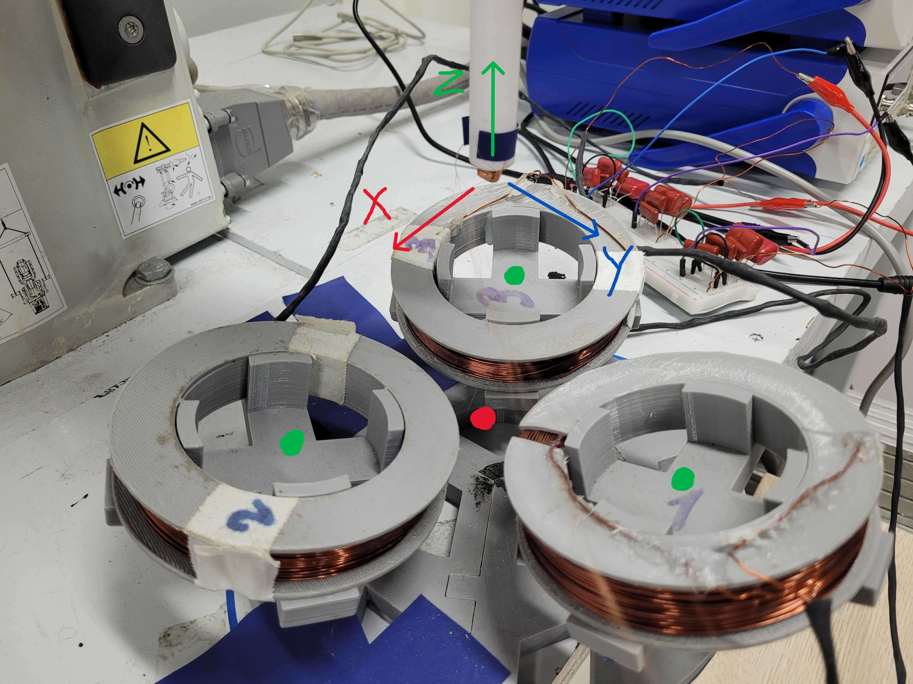
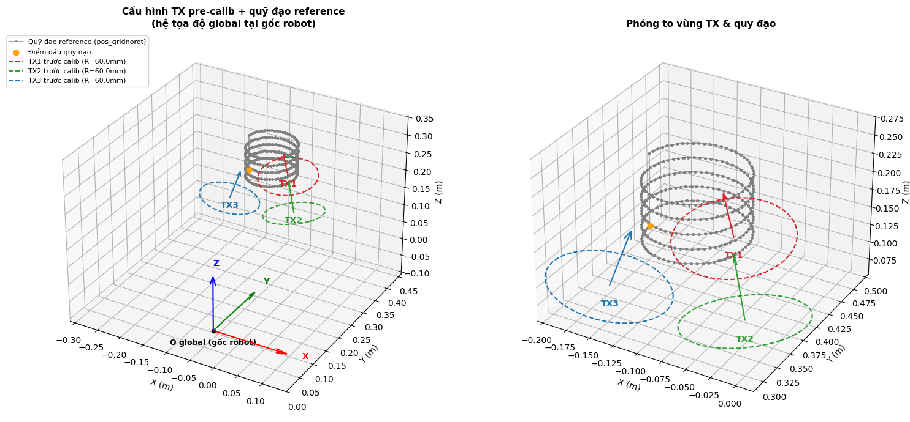

# 3 Tx - 3 Rx EMF and Pose Real Dataset
## 1. Data description
Format: `Rx1_Tx1 Rx1_Tx2 Rx1_Tx3 Rx2_Tx1 ... Rx3_Tx2 Rx3_Tx3 X Y Z Roll Pitch Yaw`
- 15 Columns:
    - 9 columns: EMF_max on Rx(i) caused by Tx(j)
    - 3 columns: Rx position in **robot coordinates** in **\[mm\]**
    - 3 columns: Roll, Pitch, Yaw of **end-effector in robot's register (NOT of Rx - have to be adjusted with code)** in **\[deg\]**
- 12000 Rows of data:
    - Divided into 3000 / 3000 / 3000 / 3000 rows for 4 different orientations
    - Each 3000 rows: 300 points in trajectory * 10 measurements per point
- Chosen Rx orientations (Euler angles in deg):
    - `[0, 0, 0]`
    - `[0, -10, 0]`
    - `[0, 10, 0]`
    - `[-10, 0, 0]`

## 2. Hardware description
- System origin w.r.t robot coordinates: \[-93.81, 378.13, 66.35\] (mm)
- Tx positions: **\[mm\]** (orientation to be added)

| | X | Y | Z |
| --- | --- | --- | --- |
| Tx1 | -102.05 | 460.84 | 89.86 |
| Tx2 | -26.68 | 346.91 | 82.74 |
| Tx3 | -161.34 | 335.03 | 84.16 |

- Rx initial orientation\
**True normal vectors**

| | norm_vec w.r.t system |
| --- | --- |
| Rx1 | \[0, 1, 0\] |
| Rx2 | \[0, 0, 1\] |
| Rx3 | \[1, 0, 0\] |

**Robot-mounting offset angles**
\[roll_os, pitch_os, yaw_os\] = \[179.91, 0.01, 66.28\] (deg)
- Real system:\ 
    - Red dot: system origin
    - Green dots: Tx centers
    - Arrows: x, y, z directional vectors of system/initial Rx orientation

## 3. **IMPORTANT**: Removing offset from Pose values in data files
- Position offset: subtract all Tx, Rx positions by \[-93.81, 378.13, 66.35\] (mm) (system origin w.r.t robot frame)
- Euler angles offset: implement Rx_angle_remove_offset.py code
    - Initial end-effector offset (seen on pendant) when Rx is not tilted: `EX_init, EY_init, EZ_init`
    - End-effector angle (seen on pendant) at arbitrary Rx pose: `ori_in = data[:, 12:15] # from CSV file` (N_samples x 3_Ori matrix)
    - Actual Rx's Euler angles at said pose: `ori_out` (N_samples x 3_Ori matrix)

## 4. Other details
- Approximate Tx parameters after calibration: to be added
- Trajectories:
    - Cylindrical:\
    
    - Conical:\
    - Grid:\
