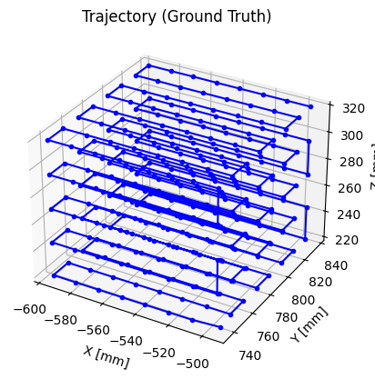
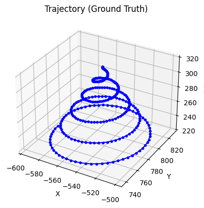
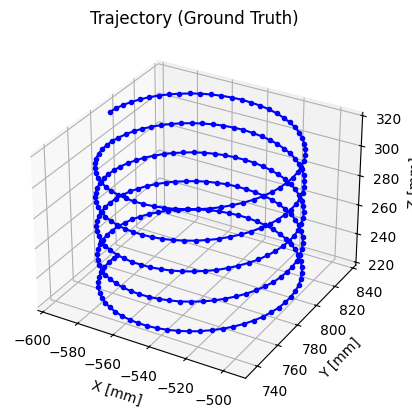

# 3-Tx---3-Rx-EMF-and-Position-Data
Includes Data and Position files
1. Data files
- Use these files for Tx calibration, model training and testing
- Files contain Rx positions and angles with offset **removed** (angle offset due to Rx mounting to robot)
- Data format: `Rx1-Tx1 Rx1-Tx2 Rx1-Tx3 Rx2-Tx1 ... Rx3-Tx2 Rx3-Tx3 Pos_X Pos_Y Pos_Z Ang_X Ang_Y Ang_Z`
  - 9 columns of EMF data - 3 columns of Rx position **\[mm\]** - 3 columns of Rx Euler angle **\[deg\]**
2. Position files
- Rx positions and angles with offset **kept**
- Use these files when robot offset is needed
  - Format: `Pos_X Pos_Y Pos_Z Ang_X Ang_Y Ang_Z`
  - 3 columns of Rx position **\[m\]** - 3 columns of Rx Euler angle **\[deg\]**
3. Other details
- \[Approximate\] Tx placement after calibration: (units: mm and deg)\

|  | Pos_X | Pos_Y | Pos_Z | Ang_X | Ang_Y | Ang_Z | k_Rx1 | k_Rx2 | k_Rx3 |
| --- | --- | --- | --- | --- | --- | --- | --- | --- | --- |
| Tx1 | -0.4796 | 0.7997 | 0.1325 | 179.5725 | -18.9595 | 145.3704 | 15.2993 | 37.6829 | 47.3702
| Tx2 | -0.5863 | 0.7109 | 0.1383 | 23.9145 | 166.5116 | -27.2473 | 10.1854 | 25.5442 | 29.5400
| Tx3 | -0.5942 | 0.8462 | 0.1363 | 150.1916 | 5.0969 | -35.7094 | 8.0319 | 19.9425 | 22.6538

- Coordinate origin \[0, 0, 0\] at robot's origin
- Trajectory (no rotation):
  - gridnorot:
\
  - conenorot:
\
  - cylnorot:
\
